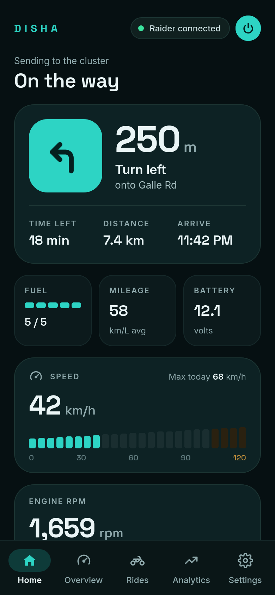
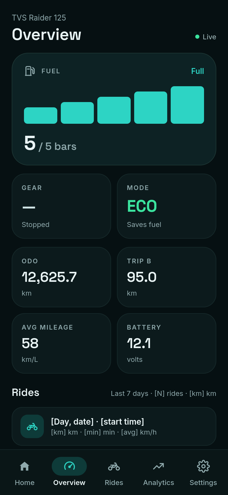
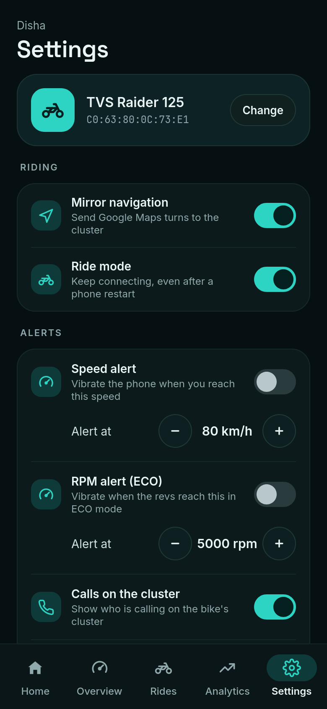
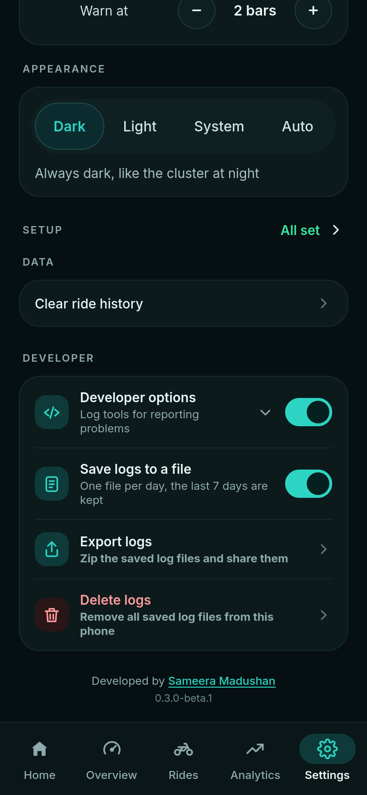
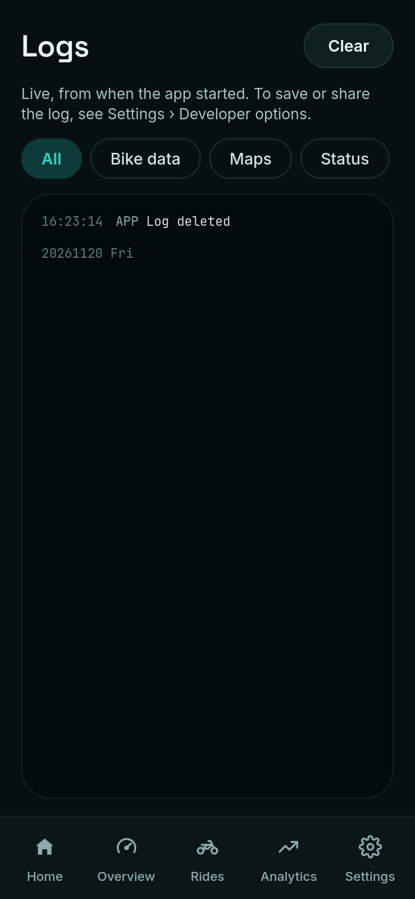

<div align="center">


# Disha

<sub><i>Disha (දිශා)</i> · "directions" in Sinhala</sub>

**Google Maps turn-by-turn navigation on your TVS SmartXonnect cluster.**

The next turn, how far to it, and how long to go, on the bike's own screen, with your phone in your pocket.

[](https://github.com/sameeramperera/Disha/releases)
[-3DDC84)](#bikes-and-phones)
[](#building-from-source)
[](#beta)

<p align="center">
  <picture>
    <source media="(prefers-color-scheme: light)" srcset="docs/screens/home-light.png">
    
  </picture>
  <picture>
    <source media="(prefers-color-scheme: light)" srcset="docs/screens/overview-light.png">
    
  </picture>
  <picture>
    <source media="(prefers-color-scheme: light)" srcset="docs/screens/rides-light.png">
    
  </picture>
  <picture>
    <source media="(prefers-color-scheme: light)" srcset="docs/screens/analytics-light.png">
    
  </picture>
  <picture>
    <source media="(prefers-color-scheme: light)" srcset="docs/screens/settings-light.png">
    
  </picture>
  <picture>
    <source media="(prefers-color-scheme: light)" srcset="docs/screens/settings-more-light.png">
    
  </picture>
  <picture>
    <source media="(prefers-color-scheme: light)" srcset="docs/screens/logs-light.png">
    
  </picture>
</p>

</div>

## Why Disha

TVS Connect, the official app, can show directions on the cluster, but its
maps are often not accurate enough. Wrong turns, missing roads, and
routes that do not match what Google Maps would take. Most riders already
trust Google Maps, so Disha was built to put **Google Maps' directions** on the
cluster instead.

- **Works with the Google Maps you already use.** No separate maps, no
  downloads, no account. Start a trip in Google Maps and Disha follows it.
- **Starts by itself.** When you start navigation in Google Maps, Disha connects to the
  bike on its own. Switch the ignition off and on, and it reconnects within
  seconds. Tap the navigation card in Disha to jump back to the trip in
  Google Maps, or **Disconnect** on Disha's notification to stop it.
- **Shows your bike's data.** Engine RPM, the gear you're in, ECO or POWER
  mode, fuel, odometer, trip B, average mileage and battery voltage, read live
  from the bike.
- **Warns you.** The phone vibrates when you reach a speed you set, or when the
  revs pass a limit you set in ECO mode, even on silent. You get a notification
  when the fuel runs low.
- **Shows who is calling.** When a call comes in, from the phone app, WhatsApp
  or another calling app, the caller's name shows on the cluster while it rings.
  Turn off **Calls on the cluster** in Settings if you don't want it.
- **Keeps your rides, all of them.** Every ride is recorded from the bike's own
  speed and odometer. **Rides** lists them, newest first, with the ride in
  progress on top. **Analytics** shows your distance for the week, month,
  year or all time, how it compares with the period before, riding time,
  average and top speed, mileage, and a chart of the distance per day or month.
- **Shows how you ride.** Analytics also shows time and distance in ECO and
  POWER, mileage in each mode, time in each gear and shifts, RPM habits, idling
  and throttle. Tap a ride in **Rides** to see the same for that ride.
- **Works your way.** Switch off **Mirror navigation** to keep turns off the
  cluster, or **Ride mode** to stop Disha reconnecting after a phone restart.
  Pick a dark or light look, follow the phone, or let **Auto** go dark from
  6 PM to 6 AM. Long-press the bike's name in **Settings** to give it your own.
- **Helps with bug reports.** **Settings › Developer options** shows the live
  log, saves it as one file per day (the last 7 days are kept), and exports
  them as a zip to attach to an issue.
- **Nothing leaves your phone.** Disha has no internet permission at all.

## Get started

1. **Install it:** download `Disha.apk` from
   [Releases](https://github.com/sameeramperera/Disha/releases) and open it.
   Allow *Install unknown apps* when Android asks.
2. **Complete the setup list** in **Settings → Setup**. If anything is
   missing, Home shows a *Finish setup* card that takes you there. Each item
   has a **Fix** button:
   - **Bluetooth & notifications** — lets the app talk to the bike
   - **Read Google Maps** — needed to see the turn arrows
   - **Run with screen off** — stops the phone pausing navigation
3. **Find your bike:** switch the ignition on, tap the power button on Home
   (or **Find** in Settings), and pick it from the list. Likely bikes are marked with a star. Disha remembers it.
4. **Ride:** start navigation in Google Maps. The directions show up on the
   cluster.


> [!IMPORTANT]
> <a id="beta"></a>**Disha is in beta.** It has been tested on the TVS Raider.
> It may work on other SmartXonnect bikes, but that is not tested or guaranteed, and
> support for other bikes is not planned. If something
> looks wrong, please [open an issue](https://github.com/sameeramperera/Disha/issues)
> and attach the log (**Settings › Developer options › Export logs** in the app).


## How it works

1. **Google Maps** shows an ongoing notification while it navigates: the road,
   the distance to the next turn, the time and distance left, and the turn
   arrow as a picture.
2. **Disha reads that notification** (this is the *Read Google Maps*
   permission). It reads the text for the numbers, and works out the turn from
   the shape of the arrow picture.
3. **It sends the update to the cluster** over Bluetooth LE, in the same format
   TVS's own app uses, and keeps repeating it so the cluster keeps the
   navigation panel open.
4. **It sends the phone's status** every 2 seconds, like TVS's app: the phone
   battery level and the time. This keeps the cluster clock right, and the
   bike only starts sending its own data after the first one.
5. **The bike sends back** its speed, odometer, engine RPM, throttle and ride
   mode about three times a second, plus the gear, fuel, trip B, mileage and
   battery. Disha shows these, records rides from them, and checks them for the
   speed, RPM and low-fuel alerts.


## Bikes and phones

<table>
<tr><td><b>Bike</b></td><td>Built for the <b>TVS Raider</b> with SmartXonnect. Other SmartXonnect bikes may work, but are not supported.</td></tr>
<tr><td><b>Phone</b></td><td>Android 9 or newer, with Bluetooth LE.</td></tr>
<tr><td><b>Google Maps</b></td><td>Set to <b>English</b>. Disha reads Maps' words, so other languages are not understood yet.</td></tr>
</table>

Tried it on another bike? You are welcome to say how it went in an
[issue](https://github.com/sameeramperera/Disha/issues), but fixes for other
bikes are not planned.

## Privacy and permissions

Disha has **no internet permission**. It cannot send anything anywhere. There
is no account, no cloud and no tracking. Everything stays on your phone:

- Your bike and your rides are saved inside the app.
- The log is kept on the phone, and leaves it only when you tap **Export logs**
  (Settings › Developer options). Turn off **Save logs to a file** there to stop keeping it.
  It explains the bike's data in plain words, and can be filtered to bike
  data, Maps or status lines (Settings › Developer options › Open logs).

<details>
<summary><b>Every permission, and why</b></summary>

<br>

<table>
<tr><td><code>BIND_NOTIFICATION_LISTENER_SERVICE</code></td><td>To read Google Maps' navigation notification, and incoming-call notifications so the cluster can show who is calling. Disha ignores all other notifications.</td></tr>
<tr><td><code>BLUETOOTH_SCAN</code>, <code>BLUETOOTH_CONNECT</code></td><td>To find the bike and talk to it.</td></tr>
<tr><td><code>BLUETOOTH</code>, <code>BLUETOOTH_ADMIN</code>, <code>ACCESS_FINE_LOCATION</code></td><td>The same, on older Android versions, which need location permission for any Bluetooth scan. Disha never reads your location.</td></tr>
<tr><td><code>FOREGROUND_SERVICE</code>, <code>FOREGROUND_SERVICE_CONNECTED_DEVICE</code></td><td>To keep the link to the bike alive while you ride with the screen off.</td></tr>
<tr><td><code>POST_NOTIFICATIONS</code></td><td>For the notification Android requires while the link is running, and the low-fuel warning.</td></tr>
<tr><td><code>VIBRATE</code></td><td>To vibrate the phone for the speed and RPM alerts.</td></tr>
<tr><td><code>REQUEST_IGNORE_BATTERY_OPTIMIZATIONS</code></td><td>To ask Android not to pause Disha with the screen off.</td></tr>
<tr><td><code>RECEIVE_BOOT_COMPLETED</code></td><td>To start waiting for the bike again after the phone restarts (unless <b>Ride mode</b> is off).</td></tr>
</table>

</details>

## Building from source

Needs only Java 17 or newer, `curl` and `unzip`. No Android Studio, no Gradle.

```sh
tools/fetch.sh                  # once: the Eclipse compiler, Android build-tools 34 and platform 34
./build.sh 0.5.0-beta.2 7       # version name, version code (these are also the defaults)
```

`build.sh` compiles the resources with `aapt2`, the Java with `ecj`, dexes with
`d8`, then aligns and signs the result. The signed APK is written to
`Disha.apk`.

- **Version:** the middle number goes up for a release with new features, and
  `-beta.N` for a fix build. The version code must go up with every build you
  install, or Android refuses the update.
- **Signing:** the APK is signed with `tools/disha.keystore`. The password is read
  from `DISHA_KS_PASS`, or asked for. If there is no keystore, a new one is made,
  so your own builds cannot update the official release (uninstall it first, which
  deletes its saved rides).
- **Java:** a Java runtime in `tools/jre` is used if there is one, otherwise the
  system's `java`.


## Disclaimer

Disha is an independent, unofficial project. It is not affiliated with,
endorsed by, or connected to TVS Motor Company or Google in any way. TVS,
TVS Connect, SmartXonnect and Raider are trademarks of TVS Motor Company.
Google Maps is a trademark of Google LLC. These names are used only to
describe what Disha works with.

Use it at your own risk. Keep your eyes on the road, and do not handle your
phone while riding.
