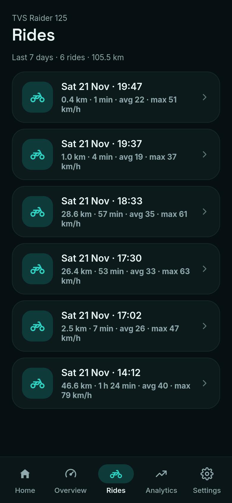
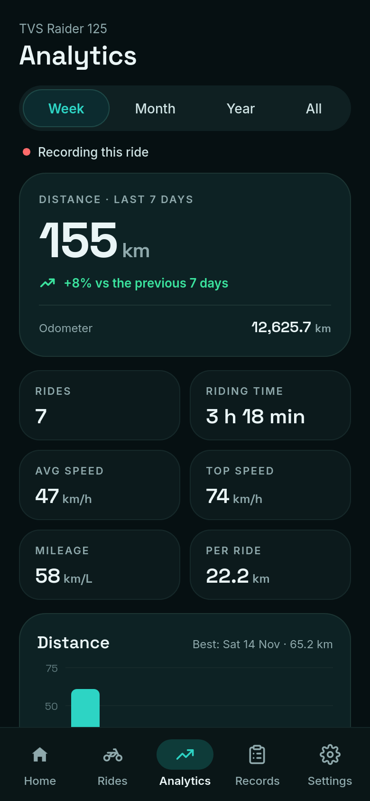
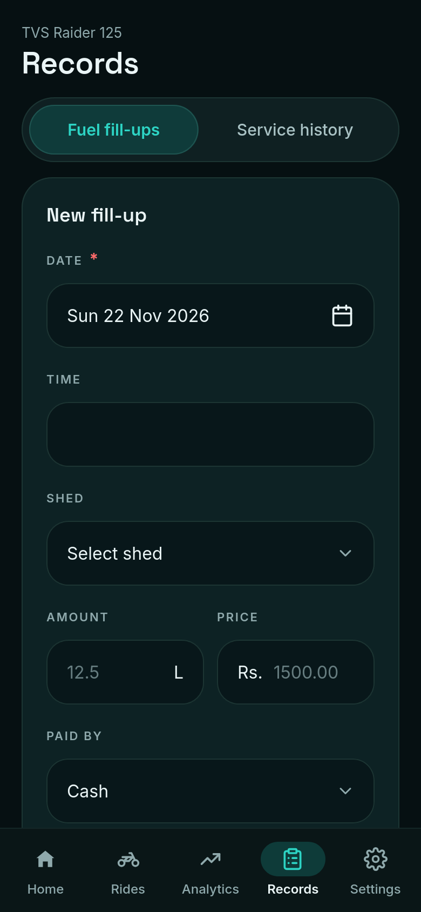

<div align="center">


# Disha

<sub><i>Disha (දිශා)</i> · "directions" in Sinhala</sub>

**Google Maps turn-by-turn navigation on your TVS SmartXonnect cluster.**

The next turn, how far to it, and how long to go, on the bike's own screen, with your phone in your pocket.

[](https://github.com/sameeramperera/Disha/releases/latest)
[-3DDC84)](#bikes-and-phones)
[](#building-from-source)
[](#tested)
[](https://claude.com/claude-code)

<p align="center">
  <picture>
    <source media="(prefers-color-scheme: light)" srcset="docs/screens/home-light.png">
    
  </picture>
  <picture>
    <source media="(prefers-color-scheme: light)" srcset="docs/screens/rides-light.png">
    
  </picture>
  <picture>
    <source media="(prefers-color-scheme: light)" srcset="docs/screens/analytics-light.png">
    
  </picture>
  <br>
  <picture>
    <source media="(prefers-color-scheme: light)" srcset="docs/screens/records-light.png">
    
  </picture>
  <picture>
    <source media="(prefers-color-scheme: light)" srcset="docs/screens/settings-light.png">
    
  </picture>
  <picture>
    <source media="(prefers-color-scheme: light)" srcset="docs/screens/logs-light.png">
    
  </picture>
</p>

</div>

## Why Disha

TVS Connect, the official app, can show directions on the cluster, but its
maps are often not accurate enough. Wrong turns, missing roads, and
routes that do not match what Google Maps would take. Most riders already
trust Google Maps, so Disha was built to put **Google Maps' directions** on the
cluster instead.

- **Uses your Google Maps.** Start a trip in Google Maps and the turns show on
  the cluster. No other maps, downloads or account.
- **Connects by itself** when you start navigating, and reconnects within
  seconds after the ignition goes off and on.
- **Shows your bike's data** on Home: RPM, gear, ECO or POWER, fuel, odometer,
  trip B, mileage and battery.
- **Warns you** with a vibration at the speed or RPM you set, and a
  notification when fuel runs low.
- **Shows who is calling** on the cluster while the phone rings.
- **Keeps every ride**, with stats by week, month, year or all time, and how
  you ride: ECO and POWER, gears, RPM, idling and throttle.
- **Keeps fuel and service records**, reminds you the day before your next
  service, and shows what each km costs.
- **Backs up your data** to a file you choose, every day or when you tap, and
  restores it. Exports rides, fill-ups and services as CSV.
- **Works your way:** dark or light look, your own bike name, and switches to
  turn off what you don't need.
- **Helps with bug reports:** export the log from Settings › Developer options.
- **Nothing leaves your phone** unless you export it. Disha has no internet permission.

## Get started

1. **Install it:** download `Disha.apk` from the
   [latest release](https://github.com/sameeramperera/Disha/releases/latest) and open it.
   Allow *Install unknown apps* when Android asks. Updating from an older
   version, a beta included? Install over it: your bike, rides and records are kept.
2. **Complete the setup list** in **Settings → Setup**. If anything is
   missing, Home shows a *Finish setup* card that takes you there. Each item
   has a **Fix** button:
   - **Bluetooth & notifications** — lets the app talk to the bike
   - **Read Google Maps** — needed to see the turn arrows
   - **Run with screen off** — stops the phone pausing navigation
3. **Find your bike:** switch the ignition on, tap the power button on Home
   (or **Find** in Settings), and pick it from the list. Likely bikes are marked with a star. Disha remembers it.
4. **Ride:** start navigation in Google Maps. The directions show up on the
   cluster.


> [!IMPORTANT]
> <a id="tested"></a>**Disha is tested on the TVS Raider.**
> It may work on other SmartXonnect bikes, but that is not tested or guaranteed, and
> support for other bikes is not planned. If something
> looks wrong, please [open an issue](https://github.com/sameeramperera/Disha/issues)
> and attach the log (**Settings › Developer options › Export logs** in the app).


## How it works

1. **Google Maps** shows an ongoing notification while it navigates: the road,
   the distance to the next turn, the time and distance left, and the turn
   arrow as a picture.
2. **Disha reads that notification** (this is the *Read Google Maps*
   permission). It reads the text for the numbers, and works out the turn from
   the shape of the arrow picture.
3. **It sends the update to the cluster** over Bluetooth LE, in the same format
   TVS's own app uses, and keeps repeating it so the cluster keeps the
   navigation panel open.
4. **It sends the phone's status** every 2 seconds, like TVS's app: the phone
   battery level and the time. This keeps the cluster clock right, and the
   bike only starts sending its own data after the first one.
5. **The bike sends back** its speed, odometer, engine RPM, throttle and ride
   mode about three times a second, plus the gear, fuel, trip B, mileage and
   battery. Disha shows these, records rides from them, and checks them for the
   speed, RPM and low-fuel alerts.


## Bikes and phones

<table>
<tr><td><b>Bike</b></td><td>Built for the <b>TVS Raider</b> with SmartXonnect. Other SmartXonnect bikes may work, but are not supported.</td></tr>
<tr><td><b>Phone</b></td><td>Android 9 or newer, with Bluetooth LE.</td></tr>
<tr><td><b>Google Maps</b></td><td>Set to <b>English</b>. Disha reads Maps' words, so other languages are not understood yet.</td></tr>
</table>

Tried it on another bike? You are welcome to say how it went in an
[issue](https://github.com/sameeramperera/Disha/issues), but fixes for other
bikes are not planned.

## Privacy and permissions

Disha has **no internet permission**. It cannot send anything anywhere. There
is no account, no cloud and no tracking. Everything stays on your phone, unless you
export it or save a backup somewhere else:

- Your bike, your rides, and your fill-ups and services are saved inside the app.
- Backups and CSV exports (Settings › Your data) are written only to the file you
  choose, and auto backup is off until you turn it on. A backup is a plain file that
  also holds your settings and your bike's Bluetooth address. If you put it in a cloud
  folder, that cloud app uploads it.
- **Delete all data** (Settings › Your data) removes your rides, fill-ups and services.
- The log is kept on the phone, and leaves it only when you tap **Export logs**
  (Settings › Developer options). Turn off **Save logs to a file** there to stop keeping it.
  It explains the bike's data in plain words, and can be filtered to bike
  data, Maps or status lines (Settings › Developer options › Open logs).

<details>
<summary><b>Every permission, and why</b></summary>

<br>

<table>
<tr><td><code>BIND_NOTIFICATION_LISTENER_SERVICE</code></td><td>To read Google Maps' navigation notification, and incoming-call notifications so the cluster can show who is calling. Disha ignores all other notifications.</td></tr>
<tr><td><code>BLUETOOTH_SCAN</code>, <code>BLUETOOTH_CONNECT</code></td><td>To find the bike and talk to it.</td></tr>
<tr><td><code>BLUETOOTH</code>, <code>BLUETOOTH_ADMIN</code>, <code>ACCESS_FINE_LOCATION</code></td><td>The same, on older Android versions, which need location permission for any Bluetooth scan. Disha never reads your location.</td></tr>
<tr><td><code>FOREGROUND_SERVICE</code>, <code>FOREGROUND_SERVICE_CONNECTED_DEVICE</code></td><td>To keep the link to the bike alive while you ride with the screen off.</td></tr>
<tr><td><code>POST_NOTIFICATIONS</code></td><td>For the notification Android requires while the link is running, the low-fuel warning, the service reminder, and a notice if a backup fails.</td></tr>
<tr><td><code>VIBRATE</code></td><td>To vibrate the phone for the speed and RPM alerts.</td></tr>
<tr><td><code>REQUEST_IGNORE_BATTERY_OPTIMIZATIONS</code></td><td>To ask Android not to pause Disha with the screen off.</td></tr>
<tr><td><code>RECEIVE_BOOT_COMPLETED</code></td><td>To start waiting for the bike again after the phone restarts (unless <b>Ride mode</b> is off), and to set the service reminder and the daily backup again.</td></tr>
</table>

</details>

## Building from source

Needs only Java 17 or newer, `curl` and `unzip`. No Android Studio, no Gradle.

```sh
tools/fetch.sh                  # once: the Eclipse compiler, Android build-tools 34 and platform 34
./build.sh 1.0.0 9              # version name, version code (these are also the defaults)
```

`build.sh` compiles the resources with `aapt2`, the Java with `ecj`, dexes with
`d8`, then aligns and signs the result. The signed APK is written to
`Disha.apk`.

## Disclaimer

Disha is an independent, unofficial project. It is not affiliated with,
endorsed by, or connected to TVS Motor Company or Google in any way. TVS,
TVS Connect, SmartXonnect and Raider are trademarks of TVS Motor Company.
Google Maps is a trademark of Google LLC. These names are used only to
describe what Disha works with.

Use it at your own risk. Keep your eyes on the road, and do not handle your
phone while riding.
